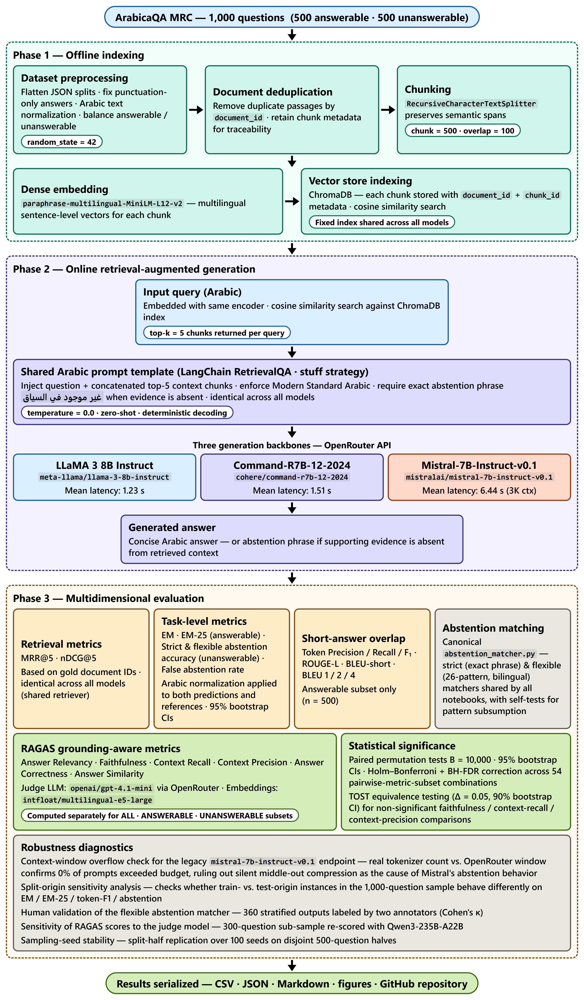

# Arabic RAG Evaluation with RAGAS (ArabicaQA) - LLaMA-3 vs Mistral vs Command-R7B

This repository provides the implementation and evaluation pipeline for the paper:

> A Comparative Study of LLM-Based Retrieval-Augmented Generation for Arabic Question Answering

It benchmarks a fixed Retrieval-Augmented Generation (RAG) setup on **ArabicaQA**, comparing three instruction-tuned LLMs under identical retrieval conditions via **OpenRouter**:

- **LLaMA-3 (8B)** (`meta-llama/llama-3-8b-instruct`)
- **Mistral-7B-Instruct** (`mistralai/mistral-7b-instruct-v0.1`)
- **Command-R7B** (`cohere/command-r7b-12-2024`)

Evaluation includes classic QA metrics, retrieval ranking metrics, **RAGAS** grounding-aware metrics, statistical significance analysis with multiple-comparisons correction, TOST equivalence testing, and a set of reviewer-motivated robustness diagnostics (human-validated abstention matching, context-window overflow check, split-origin sensitivity, judge-model sensitivity, sampling-seed stability).

The pipeline is organized as seven sequential notebooks (`00` through `06`), plus standalone Python scripts for abstention matching, second-judge re-scoring, and sampling-seed stability; see [Pipeline / Notebook Order](#pipeline--notebook-order) below for what each one does and the order to run them in.

---

## Project Structure

```text
├── 00_dataset-load_statis.ipynb
├── 01_sample_sample-statis.ipynb
├── 02_RAG.ipynb
├── 03_EM_EM25_ans-abstention-rate.ipynb
├── 04_RAGAS_statistical-analysis.ipynb
├── 05_extra-metrics.ipynb
├── 06_split-origin_sensitivity_analysis.ipynb
├── abstention_matcher.py         # canonical strict/flexible abstention matcher, imported by the notebooks and the scripts below
├── validate_abstention_matcher.py  # human-validation workflow for the abstention matcher (build sample / self-test / score agreement)
├── second_judge_ragas.py         # re-scores a sub-sample with a second RAGAS judge (paid API calls)
├── second_judge_compare.py       # compares the second judge with the original judge
├── second_judge_faithfulness_check.py  # shows where the two judges disagree on Faithfulness
├── check_second_judge.py         # checks the manuscript's second-judge numbers against the per-question CSV
├── seed_stability_analysis.py    # split-half sampling-seed stability analysis
├── rag_pipeline_figure.html      # source of the pipeline figure
├── rag_pipeline_figure.jpg
├── requirements.txt
├── requirements_ner.txt          # separate pinned environment for the NER step
├── .env                          # OPENROUTER_API_KEY (not committed)
├── LICENSE
├── DATASET_LICENSE
├── README.md
│
└── arabicaqa_rag_results
    ├── dataset
    ├── diagnostics
    ├── predictions
    │   └── figures_strict_flexible
    ├── statistical_analysis
    ├── split_sensitivity
    ├── annotation
    ├── second_judge
    │   └── qwen__qwen3-235b-a22b-2507
    │       └── comparison
    ├── seed_stability
    ├── ragas_full
    │   ├── figures
    │   └── figures_full
    ├── ragas_full_llama_mistral_command
    │   ├── ci_analysis
    │   └── figures
    └── extra_metrics_llama_mistral_command
        └── figures
```

### Directory Description

- `dataset/` — full ArabicaQA data structure (MRC, OpenQA) and processed evaluation subsets (e.g., 1000-example balanced sample), including intermediate analysis files and split-origin (train/test) labels for the sample.
- `diagnostics/` — data integrity checks (gold answer validation, unanswerable label audits) and the Mistral-7B context-window overflow diagnostic (per-prompt token counts, overflow rates against the endpoint's context budget).
- `predictions/` — model outputs, retrieved contexts, EM/EM25 scores, and abstention/refusal rate results.
- `statistical_analysis/` — bootstrap CI tables for EM/EM25/Token-F1 model-level metrics.
- `split_sensitivity/` — outputs of the train- vs. test-origin sensitivity analysis (per-split metric breakdown and significance tests).
- `annotation/` — human-validation materials and results for the abstention matcher: annotation guideline, per-annotator label sheets, adjudicated labels, stratum census, inter-annotator agreement, matcher precision/recall against human labels, population-weighted re-estimates, and a false-positive taxonomy.
- `second_judge/` — second-judge RAGAS scores, cost ledger, and response cache for each judge; `comparison/` holds the agreement, model-ordering, and pairwise-test results against the original judge.
- `seed_stability/` — split-half results per model, per model pair, and per metric ranking, plus a summary JSON.
- `ragas_full/` — descriptive-statistics figures for the full dataset and the 1,000-question sample (context/question/answer length, foreign-word counts, NER distributions). Despite the folder name, this does not contain RAGAS scores.
- `ragas_full_llama_mistral_command/` — RAGAS evaluation outputs, per-question scores, CI analysis, paired significance tests, TOST equivalence-testing results, and generated figures.
- `extra_metrics_llama_mistral_command/` — extra generation and retrieval metrics (ROUGE-L, BLEU, Token-F1, MRR@K, nDCG@K) and figures.

## Pipeline / Notebook Order

Run the notebooks in this order — each one reads files written by the notebook(s) before it.

1. **`00_dataset-load_statis.ipynb`**
   Loads the raw ArabicaQA MRC JSON splits, flattens them into one dataframe, and computes full-dataset descriptive statistics (lengths, foreign-word counts, NER entity distribution).
   - Reads: `arabicaqa_rag_results/dataset/MRC/{train,validation,test}.json`
   - Writes: `arabicaqa_rag_results/dataset/df_all_mrc.csv`, `.../dataset/full_arabicaQA_MRC_dataset_ner_counts.csv`, figures in `.../ragas_full/`

2. **`01_sample_sample-statis.ipynb`**
   Draws the fixed, seeded 1,000-question evaluation subset (500 answerable + 500 unanswerable) and computes sample-level descriptive statistics.
   - Reads: `arabicaqa_rag_results/dataset/df_all_mrc.csv`
   - Writes: `arabicaqa_rag_results/dataset/df_sample_1000.csv`, `.../dataset/sample_ner_counts.csv`, figures in `.../ragas_full/`

3. **`02_RAG.ipynb`** — *makes paid OpenRouter API calls*
   Builds the Chroma vector index over the sample contexts, retrieves top-k passages, generates answers with all three models via OpenRouter, merges per-model outputs into one comparison file, runs a gold-answer/answerability integrity check, and (Reviewer #1, Concern #3) runs a context-window overflow diagnostic that re-tokenizes every prompt with the real Mistral-7B-v0.1 tokenizer to check whether prompts exceeded the endpoint's context budget and were silently compressed.
   - Reads: `arabicaqa_rag_results/dataset/df_sample_1000.csv`
   - Writes: `arabicaqa_rag_results/predictions/comparison_llama_mistral_command_1000.{csv,json}` (the file every downstream notebook depends on), per-model prediction files, `.../diagnostics/*.csv`, `.../diagnostics/context_overflow_summary.json`, `.../diagnostics/mistral_prompt_lengths.csv`

4. **`03_EM_EM25_ans-abstention-rate.ipynb`**
   Computes EM and EM25 (strict + flexible abstention policies, via the shared `abstention_matcher.py` module), bootstrap CIs and pairwise significance for EM/EM25/Token-F1, and the answerable-abstention rate.
   - Reads: `arabicaqa_rag_results/predictions/comparison_llama_mistral_command_1000.csv`
   - Writes: `.../predictions/final_scores_strict_and_flexible_abstention_corrected.{csv,json,txt,md}`, `.../statistical_analysis/bootstrap_*_corrected.csv`, `.../predictions/answerable_abstention_rate_strict_and_flexible.csv`, figures in `.../predictions/figures_strict_flexible/`

5. **`04_RAGAS_statistical-analysis.ipynb`** — *makes paid OpenRouter API calls (LLM judge)*
   Runs RAGAS grounding metrics (faithfulness, answer relevancy, context precision/recall, answer similarity/correctness), bootstrap CIs, paired bootstrap and permutation significance tests, BH-FDR and Holm corrections, abstention/refusal-rate CIs, TOST equivalence testing (for RAGAS comparisons that are not statistically significant, to test whether the difference is small enough to call the models equivalent), and summary figures.
   - Reads: `arabicaqa_rag_results/predictions/comparison_llama_mistral_command_1000.csv`
   - Writes: everything under `.../ragas_full_llama_mistral_command/` (per-model/per-question/summary/NaN/latency tables, `ci_analysis/` including `ragas_equivalence_tost.csv`, `figures/`)

6. **`05_extra-metrics.ipynb`**
   Computes additional retrieval metrics (MRR@5, nDCG@5) and generation-quality metrics (ROUGE-L, BLEU, token Precision/Recall/F1) not covered by RAGAS, with summary figures and a heatmap.
   - Reads: `arabicaqa_rag_results/predictions/comparison_llama_mistral_command_1000.csv`
   - Writes: everything under `.../extra_metrics_llama_mistral_command/`

7. **`06_split-origin_sensitivity_analysis.ipynb`** (Reviewer #1, Concern #1)
   Checks whether ArabicaQA partitions the MRC task at the document or question level, reports the train/test composition of the 1,000-question sample, and re-breaks down EM/EM25/Token-F1/abstention by split origin to test whether merging train- and test-origin instances inflated the reported results.
   - Reads: `arabicaqa_rag_results/dataset/df_all_mrc.csv`, `.../dataset/df_sample_1000.csv`, `.../predictions/comparison_llama_mistral_command_1000.csv`
   - Writes: `.../dataset/split_overlap_summary.json`, `.../dataset/sample_split_labels.csv`, `.../split_sensitivity/breakdown_by_split.csv`, `.../split_sensitivity/train_vs_test_tests.csv`

### Standalone scripts

Not part of the numbered notebook sequence. The notebooks import `abstention_matcher.py`; the other scripts read files the notebooks write, so run them after notebook `04`.

- **`abstention_matcher.py`** — single canonical implementation of the strict (exact-phrase) and flexible (26-pattern, bilingual) abstention matchers. All notebooks import from this module so every reported abstention figure is produced by identical matching logic. Includes a `self_test()` that checks for dead patterns and confirms strict ⇒ flexible.
- **`validate_abstention_matcher.py`** (Reviewer #1, Concern #5) — human-validation workflow for the flexible matcher, run in three steps:
  - `build`: draws a blinded, stratified sample from the predictions file (stratified on the matcher's own flag × answerability) and writes one annotation sheet per annotator plus `ANNOTATION_GUIDELINE.txt`.
  - `check`: pipeline self-test, run once before annotating. It substitutes the matcher's own flags for the human labels and verifies that the weighted estimator reproduces the reported matcher figures exactly.
  - `score`: reads the completed sheets and reports inter-annotator agreement (Cohen's kappa), matcher precision/recall/F1 against the adjudicated human labels (with 95% bootstrap CIs), population-weighted re-estimates of abstention accuracy and false-abstention rate, and an error taxonomy for the matcher's false positives.
  - Reads/writes under `arabicaqa_rag_results/annotation/`.
- **`second_judge_ragas.py`** — *makes paid OpenRouter API calls (LLM judge)*
  Re-scores a stratified sub-sample of the archived answers with a second, independent judge (`qwen/qwen3-235b-a22b-2507`). Everything except the judge follows `04_RAGAS_statistical-analysis.ipynb`, and no answer is regenerated. Modes: `estimate` (no spend), `pilot`, and `run`. Judge responses and finished scores are cached on disk, so a rerun does not pay twice, and `--budget-usd` caps cumulative spend.
  - Reads: `arabicaqa_rag_results/ragas_full_llama_mistral_command/ragas_per_question_all_models.csv`
  - Writes: `.../second_judge/qwen__qwen3-235b-a22b-2507/`
- **`second_judge_compare.py`** — compares the two judges on the same sub-sample, without API calls: per-item Spearman agreement, mean score offsets, model orderings, and the direction and significance of each pairwise model difference under each judge (paired permutation test, B = 10,000, Holm correction).
  - Writes: `.../second_judge/qwen__qwen3-235b-a22b-2507/comparison/`
- **`second_judge_faithfulness_check.py`** — optional and descriptive, without API calls. Breaks the Faithfulness disagreement between the judges down by model, subset, and abstention.
  - Writes: `.../comparison/faithfulness_by_abstention.csv`
- **`check_second_judge.py`** — recomputes the manuscript's second-judge numbers from `second_judge_per_question.csv`, using the standard library only. Context Recall/Precision rows and anything computed on the full 1,000 questions cannot be checked from this file.
- **`seed_stability_analysis.py`** — sampling-seed stability analysis, with no new generation or judging. For each of 100 seeds, it splits the 1,000 questions into two disjoint halves of 500, stratified by answerability, recomputes every metric and pairwise comparison on each half, and records whether both halves reproduce the full-sample direction, significance, and model ordering.
  - Reads: `arabicaqa_rag_results/predictions/comparison_llama_mistral_command_1000.csv`, `.../ragas_full_llama_mistral_command/ragas_per_question_all_models.csv`
  - Writes: `.../seed_stability/`

---

## Dataset

This work uses the ArabicaQA dataset:
<https://huggingface.co/datasets/abdoelsayed/ArabicaQA>

## System Overview



```text
Question
   |
   v
Retriever (MiniLM + Chroma)
   |
   V
Top-k Context
   |
   V
LLM (LLaMA-3 / Mistral / Command-R7B via OpenRouter)
   |
   V
Answer
   |
   V
Task / Retrieval / RAGAS Evaluation
   |
   V
Statistical Significance Analysis
```

## Method Summary

### RAG pipeline (fixed across models)

1. Load ArabicaQA contexts and questions
2. Chunk contexts into overlapping passages
3. Embed chunks with a multilingual sentence embedding model (paraphrase-multilingual-MiniLM-L12-v2)
4. Store embeddings in a vector DB (Chroma)
5. Retrieve top-*k* passages per query
6. Generate answers using an LLM (OpenRouter backend)
7. Evaluate using:
   - Task metrics (EM, EM25, no-answer accuracy, abstention rate — matched with a shared, human-validated abstention matcher)
   - Lexical overlap metrics (Token-F1, ROUGE-L, BLEU-short)
   - Retrieval metrics (MRR@5, nDCG@5)
   - RAGAS metrics (faithfulness, answer relevancy, context precision/recall, etc.)
   - Statistical significance (paired bootstrap/permutation tests, BH-FDR, Holm correction, TOST equivalence testing)
   - Robustness diagnostics (Mistral-7B context-window overflow check, split-origin sensitivity analysis, human validation of the flexible abstention matcher, sensitivity of RAGAS scores to the judge model, sampling-seed stability)

---

## Experimental Configuration

| Component | Value |
| --- | --- |
| Chunk size | 500 |
| Chunk overlap | 100 |
| Embedding model | paraphrase-multilingual-MiniLM-L12-v2 |
| Retriever top-k | 5 |
| Temperature | 0.0 |
| Max tokens | 64 |
| Evaluation subset size | 1000 |
| Answerable / Unanswerable | 500 / 500 |
| Random seed | 42 |
| LLM backend | OpenRouter |
| RAGAS judge | `openai/gpt-4.1-mini` |
| RAGAS embeddings | `intfloat/multilingual-e5-large` |
| Second judge (sensitivity check) | `qwen/qwen3-235b-a22b-2507`, 300-question sub-sample |
| Sampling-seed stability | 100 seeds, two disjoint halves of 500 questions |

## Installation

### 1) Create environment (recommended)

```bash
python -m venv .venv
source .venv/bin/activate   # macOS/Linux
# .venv\Scripts\activate    # Windows PowerShell
pip install -U pip
```

### 2) Install dependencies

To install dependencies use `requirements.txt`, run:

```bash
pip install -r requirements.txt
```

---

## OpenRouter Setup (LLM Inference)

This project uses [OpenRouter](https://openrouter.ai/) to access LLMs via a unified API.

1. Create a free account at <https://openrouter.ai/>
2. Generate an API key from your dashboard
3. Create a `.env` file in the project root:

```dotenv
OPENROUTER_API_KEY=your_key_here
```

`02_RAG.ipynb`, `04_RAGAS_statistical-analysis.ipynb`, and `second_judge_ragas.py` load this key automatically via `python-dotenv`. LLM inference runs through OpenRouter, so no local LLM is needed; the embedding models run locally and are downloaded on first use.

---

## How to Run

Launch Jupyter Notebook:

```bash
jupyter notebook
```

Run the notebooks **in numeric order**, top to bottom within each one — every notebook after `01` depends on files written by the notebook(s) before it (see [Pipeline / Notebook Order](#pipeline--notebook-order)):

1. `00_dataset-load_statis.ipynb`
2. `01_sample_sample-statis.ipynb`
3. `02_RAG.ipynb`
4. `03_EM_EM25_ans-abstention-rate.ipynb`
5. `04_RAGAS_statistical-analysis.ipynb`
6. `05_extra-metrics.ipynb`
7. `06_split-origin_sensitivity_analysis.ipynb`

> **Paid API calls:** `02_RAG.ipynb` (answer generation), `04_RAGAS_statistical-analysis.ipynb` (RAGAS LLM-judge scoring), and `second_judge_ragas.py` (second-judge re-scoring) call OpenRouter and incur cost per run. Avoid re-running them unnecessarily — the other notebooks and scripts only read the CSV/JSON files they produce.

### Robustness scripts

Run these from the repository root, after the notebooks. The second-judge commands below use the settings of the reported run; `estimate` prices the run without spending anything.

```bash
# Sensitivity of RAGAS scores to the judge model
python second_judge_ragas.py estimate --n-questions 300
python second_judge_ragas.py pilot --budget-usd 0.10
python second_judge_ragas.py run --n-questions 300 --budget-usd 3.00
python second_judge_compare.py
python second_judge_faithfulness_check.py

# Sampling-seed stability (no API calls)
python seed_stability_analysis.py \
    --predictions arabicaqa_rag_results/predictions/comparison_llama_mistral_command_1000.csv \
    --ragas arabicaqa_rag_results/ragas_full_llama_mistral_command/ragas_per_question_all_models.csv \
    --reference arabicaqa_rag_results/predictions/final_scores_strict_and_flexible_abstention_corrected.csv \
    --ragas-reference arabicaqa_rag_results/ragas_full_llama_mistral_command/ragas_summary_means.csv \
    --paper-pvalues arabicaqa_rag_results/ragas_full_llama_mistral_command/ci_analysis/paired_permutation_pvalues_all_corrections.csv \
    --out-dir arabicaqa_rag_results/seed_stability
```

For the human-validation workflow, see the usage notes at the top of `validate_abstention_matcher.py`.

### Expected outputs

Depending on your notebook settings, you will typically produce:

- Model predictions (answers) for all three models
- Retrieved contexts per query
- Metric tables (per subset / overall)
- RAGAS score reports (JSON/CSV)
- Bootstrap CI tables (RAGAS metrics, latency, abstention rates)
- Paired significance test results (with BH-FDR and Holm corrections)
- Human-validation, second-judge, and sampling-seed stability reports
- Summary plots

---

## Evaluation Metrics

### Task-level

- **EM** (Exact Match after normalization)
- **EM25**: character-prefix-strip exact match — a prediction is scored correct if it exactly matches a reference answer after stripping 0–25 leading characters from the normalized prediction, tolerating verbose response prefixes common in instruction-tuned models.
- **No-answer accuracy** (for unanswerable subset)
- **Abstention rate** (strict and flexible)
- **Answerable refusal rate** (incorrect abstention on answerable questions)

### Overlap / short-answer metrics

- **Token-F1**
- **ROUGE-L**
- **BLEU-short**

### Retrieval ranking

- **MRR@5**
- **nDCG@5**

### RAGAS (grounding-aware)

- **Faithfulness**
- **Answer Relevancy**
- **Context Precision**
- **Context Recall**
- **Answer Similarity**
- **Answer Correctness**

### Statistical analysis

- **Bootstrap 95% CI** — per metric, per model, per subset (ALL / ANSWERABLE / UNANSWERABLE)
- **Paired permutation / bootstrap significance tests** — all model pairs, per metric, B = 10,000
- **Benjamini-Hochberg FDR correction** — controls false discovery rate across multiple comparisons
- **Holm correction** — family-wise error rate control
- **TOST equivalence testing** — two one-sided tests (pre-specified margin, 90% bootstrap CI) used to argue equivalence, not just non-significance, for RAGAS comparisons (faithfulness, context recall, context precision) that fail to reach significance

### Robustness diagnostics

- **Human-validated abstention matching** — a stratified sample of 360 model outputs (120 per model) is independently labeled by two human annotators; inter-annotator agreement (Cohen's kappa) and the matcher's precision/recall/F1 against the adjudicated labels are reported, alongside population-weighted re-estimates of abstention accuracy and false-abstention rate
- **Context-window overflow diagnostic** — re-tokenizes every prompt sent to the legacy `mistral-7b-instruct-v0.1` endpoint to check whether any exceeded its context budget and were silently compressed by OpenRouter
- **Split-origin sensitivity analysis** — tests whether train- and test-origin instances within the 1,000-question evaluation sample score differently, to rule out partition-merging bias
- **Sensitivity of RAGAS scores to the judge model** — a stratified 300-question sub-sample (150 answerable, 150 unanswerable) is re-scored with `qwen/qwen3-235b-a22b-2507`, to test whether the model comparisons hold under a second, independent judge
- **Sampling-seed stability** — split-half replication over 100 seeds on disjoint 500-question halves, to test whether the model differences depend on the particular questions sampled

---

## Reproducibility Notes

This repo aims to make comparisons fair by:

- Keeping the retriever fixed across models
- Using consistent chunking / top-k retrieval settings
- Using deterministic generation settings when possible (temperature=0)
- Saving retrieved contexts for consistent scoring
- Using the same OpenRouter API endpoint for all models
- Validating internal validity with reviewer-motivated robustness checks (context-window overflow diagnostic, split-origin sensitivity analysis, human-validated abstention matching, second-judge sensitivity, sampling-seed stability)

To reproduce exactly, ensure:

- Same dataset version / split seed
- Same chunking parameters
- Same embedding model
- Same top-k retrieval value
- Same decoding configuration
- Same OpenRouter model IDs

---

## Results

The paper reports model trade-offs such as:

- stronger lexical overlap / answer matching vs.
- stronger grounding (faithfulness) and abstention behavior

See the paper for full tables, subset analysis (answerable vs unanswerable), RAGAS interpretation, and statistical significance findings.

---

## Citation

If you use this repository, please cite:

```bibtex
@article{almalki_arabicrag_2026,
  title={A Comparative Study of LLM-Based Retrieval-Augmented Generation for Arabic Question Answering},
  author={Zohoor Almalki,Shahad Alshehri, Shatha Alrehaili, Amjad Althagafi, and Mourad Mars},
  year={2026}
}
```

---

## Known Limitations

- Fixed dense retriever (no hybrid or reranking)
- Deterministic decoding only (temperature=0)
- Evaluation limited to ArabicaQA
- No human evaluation of overall answer quality — human annotation is limited to validating the automatic abstention matcher on a stratified sample, not to judging correctness, fluency, or grounding of generated answers directly
- Second-judge comparison covers a 300-question sub-sample, not all 1,000 questions
- Sampling-seed stability re-uses the 1,000-question sample: it tests split-half replication and does not draw new questions from ArabicaQA
- Dependent on OpenRouter API availability and model deprecation schedules (note: `mistralai/mistral-7b-instruct-v0.1` on OpenRouter was scheduled for deprecation on May 30, 2026)

## Compute Infrastructure

### Local Development Environment

- OS: Microsoft Windows 11 Home
- System Model: WRTB-WXX9
- CPU: Intel Core i7-10510U @ 1.80GHz
- RAM: 16 GB
- Python: 3.10.19

This environment was used for RAG pipeline development, retrieval experiments, and dataset analysis.

---

### LLM Inference

LLM inference for all three models (LLaMA-3, Mistral, Command-R7B) was performed via the **OpenRouter API** — no local GPU is required.

---

### Cloud Execution (RAGAS Evaluation)

RAGAS evaluation was executed on **Lambda Cloud** using:

- GPU: NVIDIA A100
- Instance type: Single-GPU configuration
- OS: Ubuntu (Lambda default image)
- Session management: tmux
- Total runtime: ~15h 59m
  - ~14–15h RAGAS evaluation
  - ~1–2h setup and execution management

Long-running jobs were managed via terminal session multiplexing (tmux) to ensure uninterrupted execution in the event of SSH or network disconnections.

During the final execution phase, the internet connection was interrupted, which prevented output from streaming to the interactive notebook interface. However, because the job was running inside a tmux session on the Lambda server, execution completed successfully and all outputs were generated and saved.

## Acknowledgments

This research was supported by **Umm Al-Qura University** (Grant Number: **26UQU44680217GSSR02**).

---

## License

### Code

The source code in this repository is licensed under the terms of the included LICENSE file.

### Dataset License

This work uses the ArabicaQA dataset.
The original dataset license is provided in DATASET_LICENSE.
